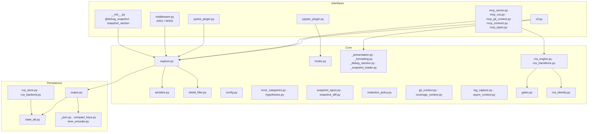
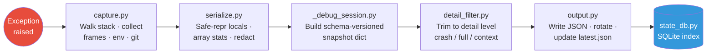
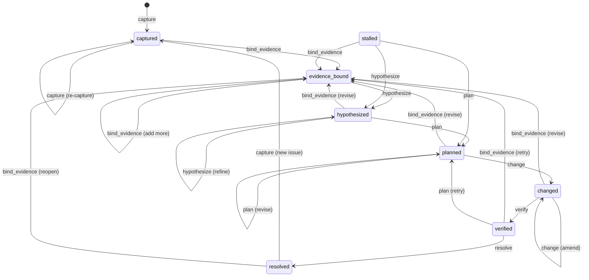

# Architecture

## Overview

**TraceGate** is a Python debugging tool that captures structured debug snapshots
optimised for LLM-assisted root-cause analysis. When an exception occurs the
capture pipeline walks the stack, serializes frames and locals, applies
redaction and detail-level filtering, and writes a self-contained JSON snapshot.
A built-in RCA (Root Cause Analysis) state machine then lets an LLM agent—or a
human—progress through an evidence-first debugging workflow, gated by
configurable verification checks. The system is accessed through six thin
interface surfaces: a `@debug_snapshot` decorator / `snapshot_section` context
manager, a pytest plugin, a CLI, an MCP server for IDE agents, Jupyter
integration, and web middleware.

## Layer Diagram

The codebase follows a strict three-layer dependency rule:
**Interfaces → Core → Persistence** (no reverse imports).



## Capture Pipeline

Every snapshot flows through the same pipeline regardless of entry point:



**Key stages:**

| Stage | Module | What happens |
|---|---|---|
| **Capture** | `capture.py` | Walks the traceback, collects N frames, source context, locals, environment, git status, async context |
| **Serialize** | `serialize.py` | Safe-repr of every local, array shape/stats extraction, PII redaction via compiled regex patterns |
| **Session** | `_debug_session.py` | Assembles the schema-versioned snapshot dict, error categorisation, hypothesis suggestions |
| **Filter** | `detail_filter.py` | Pure function that strips the snapshot to one of three disclosure levels (`crash` ≈ 2 K tokens, `full` ≈ 5 K, `context` ≈ 10 K) |
| **Output** | `output.py` | Writes the snapshot file, maintains `latest.json` symlink, enforces `max_snapshots` rotation, indexes metadata into SQLite |

## RCA Workflow

The RCA subsystem models debugging as a state machine. An LLM agent (via MCP)
or a human (via CLI) advances through states by submitting actions. Gate logic
enforces evidence-first discipline.

### State Machine



### Gate Modes

Gates evaluate whether an action should be allowed given the current state and
evidence quality. Three modes control strictness:

| Mode | Behaviour |
|---|---|
| **off** | No checks; all transitions allowed |
| **soft** (default) | Warnings emitted but action proceeds |
| **strict** | Missing prerequisites block the action |

Stall detection kicks in after a configurable number of repeated attempts in the
same state (default: 3), moving the session to `stalled` with coaching hints.

## Module Map

| Module | Layer | Responsibility |
|---|---|---|
| `__init__.py` | Interface | Public API: `@debug_snapshot`, `snapshot_section`, `install_hooks` |
| `cli.py` | Interface | Click-based CLI: `llmdebug show`, `llmdebug diff`, `llmdebug list` |
| `mcp_server.py` | Interface | MCP server exposing tools to IDE agents (stdio transport) |
| `mcp_rca.py` | Interface | MCP tools for RCA state transitions |
| `mcp_git_context.py` | Interface | MCP tool for enhanced git context |
| `mcp_contract.py` / `mcp_types.py` | Interface | MCP response formatting and type contracts |
| `pytest_plugin.py` | Interface | Automatic snapshot capture on test failures |
| `jupyter_plugin.py` | Interface | IPython/Jupyter exception-hook integration |
| `middleware.py` | Interface | ASGI and WSGI middleware for web frameworks |
| `capture.py` | Core | Central capture pipeline: stack walking, frame collection |
| `serialize.py` | Core | Safe serialization, array stats, PII redaction |
| `config.py` | Core | `SnapshotConfig` dataclass and type aliases |
| `detail_filter.py` | Core | Read-time disclosure filter (crash / full / context) |
| `error_categories.py` | Core | Automatic error classification and fix suggestions |
| `hypotheses.py` | Core | Hypothesis generation from error patterns |
| `redaction_policy.py` | Core | Profile-based redaction resolution (dev / ci / prod) |
| `hooks.py` | Core | `sys.excepthook` installation and PII pattern registry |
| `git_context.py` | Core | Git commit, branch, dirty-file collection |
| `coverage_context.py` | Core | pytest-cov coverage data enrichment |
| `async_context.py` | Core | asyncio task info capture |
| `log_capture.py` | Core | Recent log-record ring buffer |
| `rca_engine.py` | Core | Pure RCA domain logic—builds attempt records, no I/O |
| `rca_transitions.py` | Core | State transition matrix, action validation, coaching hints |
| `gates.py` | Core | Gate evaluation: off / soft / strict enforcement |
| `rca_identity.py` | Core | Failure signature and session-ID derivation |
| `snapshot_types.py` / `snapshot_diff.py` | Core | Snapshot type definitions and structured diff |
| `_debug_session.py` | Core | Schema-versioned snapshot assembly |
| `_snapshot_loader.py` | Core | Snapshot file discovery and loading |
| `_presentation.py` / `_formatting.py` | Core | Human-readable frame and snapshot formatting |
| `output.py` | Persistence | File I/O, rotation, `latest.json` management |
| `state_db.py` | Persistence | SQLite database (WAL mode) for snapshot + RCA metadata |
| `rca_store.py` | Persistence | SQLite-backed RCA record CRUD |
| `rca_backend.py` | Persistence | Backend adapter (SQLite primary, JSONL fallback) |
| `_json.py` / `compact_keys.py` | Persistence | JSON encoding, compact-key mapping |
| `toon_encoder.py` | Persistence | TOON (text-optimised object notation) format encoder |

## Key Design Decisions

- **Structured snapshots, not log dumps.** Every snapshot follows a versioned
  JSON schema so downstream consumers (LLMs, dashboards, diffs) can parse
  fields deterministically rather than scraping free-text tracebacks.

- **Three disclosure levels.** A single capture produces one full snapshot;
  `detail_filter` trims it at read time to `crash` (~2 K tokens), `full`
  (~5 K), or `context` (~10 K). This lets an LLM start cheap and escalate only
  when needed.

- **Pure-core / thin-interface split.** Capture, serialization, RCA logic, and
  gate evaluation are pure functions with no framework dependencies. Interface
  modules (`cli.py`, `mcp_server.py`, `pytest_plugin.py`, etc.) are kept thin
  and import inward only.

- **Evidence-first RCA protocol.** The state machine enforces a discipline:
  bind evidence → hypothesize → plan → change → verify → resolve. Gate modes
  let teams tune strictness from "off" (no guardrails) through "strict"
  (blocks premature fixes).

- **Safe-by-default serialization.** `serialize.py` never calls `repr()` on
  arbitrary objects directly; it uses size-bounded safe-repr, truncation limits,
  and compiled-regex redaction to avoid leaking secrets or blowing up on large
  data structures.

- **SQLite with WAL for persistence.** `state_db.py` uses WAL mode with
  busy-timeout retries so concurrent pytest workers, CLI reads, and MCP
  queries don't block each other. File-lock coordination protects the snapshot
  output directory.

- **Redaction profiles.** Three built-in profiles (`dev`, `ci`, `prod`) apply
  progressively stricter PII/secret scrubbing. A runtime warning fires if no
  profile is set, nudging users toward safer defaults.

## Dependency Rules

```
Interfaces  ──►  Core  ──►  Persistence
     │              │              │
  cli.py        capture.py     output.py
  mcp_server    serialize.py   state_db.py
  pytest_plugin rca_engine.py  rca_store.py
  middleware    gates.py       _json.py
```

1. **Interface modules import Core and Persistence—never the reverse.**
   `capture.py` must not import from `cli.py` or `mcp_server.py`.

2. **Core modules may import other Core modules and Persistence.**
   `capture.py` → `serialize.py` → `config.py` is fine.

3. **Persistence modules only import other Persistence modules or stdlib.**
   `state_db.py` does not import `capture.py`.

4. **Optional dependencies are guarded.** `click`, `rich`, `mcp`, and
   `ipython` are imported behind try/except blocks so the core library
   stays dependency-light.

These rules are enforced by code review and the architecture guardrails in
[`AGENTS.md`](../AGENTS.md). Violations show up as circular imports at
runtime and are caught by `deptry` in CI.
