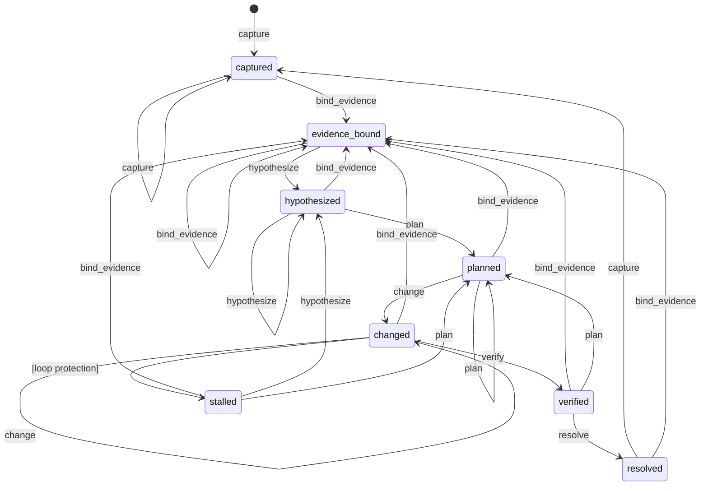

# RCA API Reference

API reference for the Root Cause Analysis (RCA) workflow system in `llmdebug`.
For the evidence-first philosophy and worked examples, see the
[Evidence-First Protocol](evidence_first_protocol.md). For MCP envelope schemas,
see the [MCP Reference](mcp-reference.md).

## Overview

The RCA subsystem provides a structured state machine that guides debugging
sessions through evidence-grounded steps: capture a failure, bind evidence,
form a hypothesis, plan an experiment, apply a change, verify, and resolve.
Configurable gate modes enforce (or gently nudge) adherence to this protocol,
preventing guess-and-patch loops and ensuring every fix traces back to concrete
evidence.

The system is split into layered modules:

| Module | Role |
|--------|------|
| `rca_transitions` | Pure state machine: states, actions, transition matrix |
| `gates` | Gate evaluation logic (off / soft / strict) |
| `rca_engine` | Domain engine — builds attempt records without I/O |
| `rca_state` | Public API facade — advance, status, history |
| `rca_identity` | Session ID derivation and failure signatures |
| `rca_backend` | Persistence adapter (SQLite or JSONL) |
| `rca_store` | SQLite-specific persistence helpers |
| `state_db` | SQLite schema, WAL configuration, CRUD |

## State Machine

### States

| State | Description |
|-------|-------------|
| `captured` | Initial state. A failure has been recorded. |
| `evidence_bound` | Concrete evidence (traceback, frames, diffs) is cited. |
| `hypothesized` | A falsifiable root-cause hypothesis has been stated. |
| `planned` | A minimal experiment or patch plan is defined. |
| `changed` | A focused code change tied to the plan has been applied. |
| `verified` | Verification checks have been run and results recorded. |
| `resolved` | Verification passed; the issue is closed. |
| `stalled` | Loop protection triggered — repeated signature without progress. |

### Actions

Each action drives the state machine to a target state:

| Action | Target State |
|--------|--------------|
| `capture` | `captured` |
| `bind_evidence` | `evidence_bound` |
| `hypothesize` | `hypothesized` |
| `plan` | `planned` |
| `change` | `changed` |
| `verify` | `verified` |
| `resolve` | `resolved` |

### Transition Diagram



### Stall Detection

When a failure signature repeats without hypothesis or plan advancement, the
engine marks the state `stalled` instead of the normal target. This triggers
when **all** of the following hold:

- Same failure signature as the previous attempt
- `repeat_count >= stall_threshold` (default: 3)
- No hypothesis advancement (`hypothesis_delta` not in `added`, `refined`,
  `replaced`)
- No plan advancement
- Action is one of `bind_evidence`, `change`, or `verify`

Recovery from `stalled` requires gathering new evidence (`bind_evidence`),
revising the hypothesis (`hypothesize`), or updating the plan (`plan`).

## Gate Modes

Gates control how strictly the evidence-first protocol is enforced. Set via
the `gate_mode` parameter or `LLMDEBUG_RCA_GATE_MODE` environment variable.

| Mode | Default? | Behavior |
|------|----------|----------|
| `off` | No | No checks. All transitions allowed unconditionally. |
| `soft` | **Yes** | Warns when prerequisites are missing but allows progress. |
| `strict` | No | Blocks transitions when required evidence is missing. |

### Gate Checks

The gate system evaluates these prerequisites before allowing a transition:

| Check ID | Trigger Condition | Hard Fail? | Message |
|----------|-------------------|------------|---------|
| `evidence_required` | `hypothesize`, `plan`, `change`, `verify`, `resolve` without evidence refs | Yes | Missing evidence references. |
| `hypothesis_required` | `plan`, `change`, `verify`, `resolve` without hypothesis | Yes | Missing root-cause hypothesis. |
| `plan_required` | `change`, `verify`, `resolve` without experiment plan | No | Missing experiment plan. |
| `verification_required` | `resolve` without `verification_result.status == "pass"` | Yes | Cannot resolve without passing verification. |
| `loop_protection` | `change`, `verify`, `resolve` with repeated signature exceeding exploration budget and no hypothesis change | No | Failure signature repeated without hypothesis change. |
| `illegal_transition` | An action that isn't an edge out of the current state in the diagram above (`allowed_actions`). Not checked on a session's first attempt. Checked last. | Yes | Action is not a transition from the current state. |

**Hard fail** checks block the transition in `strict` mode. In `soft` mode,
all checks produce warnings but never block.

Hypothesis, plan, change summary and evidence carry forward from the previous attempt
when a request omits them. A previous `verification_result` carries forward only while
the failure signature is unchanged and the action is not `change`: a result verified
one failure, or the code before a new change, so it can't satisfy `verification_required`
for another.

### Strict Mode Override

In `strict` mode, a blocked action can still proceed by setting both:

- `exploratory=True` — signals intentional exploration
- `override_reason="..."` — documents why the override is justified

This allows exploratory debugging without switching the entire session to
`off` mode.

### GateFeedback Object

Every gate evaluation returns a `GateFeedback` dataclass:

```python
@dataclass(frozen=True)
class GateFeedback:
    mode: GateMode            # "off" | "soft" | "strict"
    allowed: bool             # Whether the transition proceeds
    severity: GateSeverity    # "info" | "warning" | "error"
    warnings: tuple[str, ...]
    next_required: tuple[str, ...]
    triggered_checks: tuple[str, ...]
```

Serialized via `gate.to_dict()` and included in every attempt record under the
`gate_feedback` key.

## Action Matrix

Allowed actions from each state. The **first** action listed is the canonical
next step; additional actions allow backtracking or refinement.

| Current State | Allowed Actions |
|---------------|-----------------|
| `captured` | `bind_evidence`, `capture` |
| `evidence_bound` | `hypothesize`, `bind_evidence` |
| `hypothesized` | `plan`, `bind_evidence`, `hypothesize` |
| `planned` | `change`, `plan`, `bind_evidence` |
| `changed` | `verify`, `change`, `bind_evidence` |
| `verified` | `resolve`, `bind_evidence`, `plan` |
| `resolved` | `capture`, `bind_evidence` |
| `stalled` | `bind_evidence`, `hypothesize`, `plan` |

The allowed actions list is included in every attempt record under the
`allowed_actions` key and is used by MCP clients for UI guidance.

## API Reference

### `advance_rca_attempt()`

Advance the RCA state machine and persist the resulting attempt record.
This is the primary entry point for driving RCA state forward.

**Module:** `llmdebug.rca_state`

```python
def advance_rca_attempt(
    *,
    out_dir: str,
    request: RCAAttemptRequest,
) -> RCAAttemptRecord:
```

**Parameters:**

| Parameter | Type | Default | Description |
|-----------|------|---------|-------------|
| `out_dir` | `str` | — | Snapshot output directory (e.g. `".llmdebug"`). |
| `request` | `RCAAttemptRequest` | — | Grouped attempt inputs: `session_id`, `action`, `failure_signature`, `evidence_refs`, optional hypothesis/plan/change summary, verification result, and gate settings. |

**Returns:** `RCAAttemptRecord` (a `TypedDict` in `llmdebug.rca_types`) — the persisted attempt record containing:

```python
{
    "attempt_id": "1719849600000-a1b2c3d4",
    "session_id": "/path/to/project/.llmdebug::tests/test_foo.py::test_bar",
    "state": "evidence_bound",
    "failure_signature": "KeyError:a1b2c3d4e5f6g7h8",
    "repeat_count": 1,
    "evidence_refs": ["frame:0:src/parser.py:42"],
    "hypothesis": "...",
    "hypothesis_delta": "added",        # unchanged|refined|added|removed|replaced
    "experiment_plan": "...",
    "proposed_change_summary": "...",
    "verification_result": null,
    "gate_feedback": {
        "mode": "soft",
        "allowed": true,
        "severity": "info",
        "warnings": [],
        "next_required": ["State a falsifiable root-cause hypothesis."],
        "triggered_checks": []
    },
    "gate_warnings": [],
    "allowed_actions": ["hypothesize", "bind_evidence"],
    "next_required": ["State a falsifiable root-cause hypothesis."],
    "exploratory": false,
    "transition_history": [
        {
            "at": "2025-07-01T12:00:00Z",
            "action": "bind_evidence",
            "from": "captured",
            "to": "evidence_bound",
            "gate_allowed": true,
            "gate_mode": "soft"
        }
    ],
    "created_at": "2025-07-01T12:00:00Z",
    "updated_at": "2025-07-01T12:00:00Z"
}
```

**Raises:** `ValueError` if `action` is not a valid RCA action.

---

### `get_rca_status()`

Return the latest RCA attempt for a session.

**Module:** `llmdebug.rca_state`

```python
def get_rca_status(
    *,
    out_dir: str,
    session_id: str | None = None,
) -> dict[str, Any] | None:
```

**Parameters:**

| Parameter | Type | Default | Description |
|-----------|------|---------|-------------|
| `out_dir` | `str` | — | Snapshot output directory. |
| `session_id` | `str \| None` | `None` | Filter to a specific session. If `None`, returns the latest attempt across all sessions. |

**Returns:** The latest attempt record (same shape as `advance_rca_attempt()`
return value), or `None` if no attempts exist.

---

### `get_rca_history()`

Load RCA history, newest-first.

**Module:** `llmdebug.rca_state`

```python
def get_rca_history(
    *,
    out_dir: str,
    session_id: str | None = None,
    limit: int = 20,
) -> list[dict[str, Any]]:
```

**Parameters:**

| Parameter | Type | Default | Description |
|-----------|------|---------|-------------|
| `out_dir` | `str` | — | Snapshot output directory. |
| `session_id` | `str \| None` | `None` | Filter to a specific session. |
| `limit` | `int` | `20` | Maximum records to return. |

**Returns:** List of attempt records, newest-first. Empty list if no
attempts exist.

---

### `build_failure_signature()`

Build a stable, deterministic failure fingerprint from a snapshot or raw
text output. Used to track whether the same failure is recurring across
attempts.

**Module:** `llmdebug.rca_state` (delegates to `llmdebug.rca_identity`)

```python
def build_failure_signature(
    snapshot: dict[str, Any] | None,
    *,
    stdout: str = "",
    stderr: str = "",
    normalize: bool = True,
) -> str:
```

**Parameters:**

| Parameter | Type | Default | Description |
|-----------|------|---------|-------------|
| `snapshot` | `dict \| None` | — | Parsed snapshot dict. Preferred source — uses exception type and message, crash frame location, and pytest nodeid. |
| `stdout` | `str` | `""` | Fallback: raw stdout text (used when snapshot is `None`); its last three non-empty lines are hashed. |
| `stderr` | `str` | `""` | Fallback: raw stderr text (used when snapshot is `None`), preferred over `stdout`. |
| `normalize` | `bool` | `True` | Replace run-specific values in the message or output tail before hashing: UUIDs, `0x…` addresses, absolute paths (such as `tmp_path`), hex ids of 12+ characters, and numbers become `<uuid>`, `<addr>`, `<path>`, `<hex>` and `<n>`. `False` gives the raw signature used before this option existed. |

**Returns:** A string of the form `"ExceptionType:hexdigest"` (snapshot) or
`"TextFailure:hexdigest"` (text fallback). The hex digest is the first 16
characters of an xxh64 hash of the canonicalized failure data.

**Signature stability:** Two calls with the same exception type, normalized
message, crash location (file, line, function), and nodeid produce the same
signature. This is how repeat detection and stall detection work. Without
normalization, a message that embeds a memory address, a `tmp_path` or a
count made every attempt look new, so stall detection rarely fired. The
crash line is still part of the signature, so an edit that moves the
failing line starts a new signature. The eval harness passes
`normalize=False` to keep its adaptive conditions comparable with earlier
runs.

---

### `derive_session_id()`

Derive a stable session identifier from the output directory and snapshot
metadata. Sessions group related RCA attempts for the same test or failure
context.

**Module:** `llmdebug.rca_state` (delegates to `llmdebug.rca_identity`)

```python
def derive_session_id(
    snapshot: dict[str, Any] | None,
    *,
    out_dir: str,
    fallback: str = "global",
) -> str:
```

**Parameters:**

| Parameter | Type | Default | Description |
|-----------|------|---------|-------------|
| `snapshot` | `dict \| None` | — | Parsed snapshot dict. When available, the pytest `nodeid` or snapshot `name` is used as the scope component. |
| `out_dir` | `str` | — | Resolved output directory path. |
| `fallback` | `str` | `"global"` | Scope value when no snapshot or nodeid is available. |

**Returns:** A string of the form `"/resolved/path/.llmdebug::scope"` where
`scope` is the pytest nodeid, snapshot name, or the fallback value.

---

### `evaluate_gate()`

Evaluate whether an RCA transition should proceed under the current gate
policy. This is the core gate decision function, called internally by the
RCA engine.

**Module:** `llmdebug.gates`

```python
def evaluate_gate(
    *,
    mode: str | None,
    current_state: RCAState | str | None,
    action: str,
    payload: dict[str, Any],
    repeated_signature_count: int = 1,
    exploration_budget: int = 2,
) -> GateFeedback:
```

**Parameters:**

| Parameter | Type | Default | Description |
|-----------|------|---------|-------------|
| `mode` | `str \| None` | — | Gate mode. `None` defaults to `"soft"`. |
| `current_state` | `str \| None` | — | Current RCA state before the transition; `None` for a session's first attempt, which skips `illegal_transition`. |
| `action` | `str` | — | Requested RCA action. |
| `payload` | `dict` | — | Action payload with keys: `evidence_refs`, `hypothesis`, `experiment_plan`, `verification_result`, `exploratory`, `override_reason`, `hypothesis_advanced`. |
| `repeated_signature_count` | `int` | `1` | How many times the current failure signature has been seen. |
| `exploration_budget` | `int` | `2` | How many repeats are tolerated before `loop_protection` fires. |

**Returns:** A [`GateFeedback`](#gatefeedback-object) instance.

---

### Helper Functions

These lower-level functions are used internally but are available for
custom integrations:

| Function | Module | Description |
|----------|--------|-------------|
| `normalize_action(action)` | `rca_transitions` | Validate and lowercase an action string. Raises `ValueError` on invalid input. |
| `normalize_gate_mode(mode)` | `gates` | Validate and lowercase a gate mode. Falls back to `"soft"` for unrecognized input. |
| `allowed_actions_for_state(state)` | `rca_transitions` | Return the list of valid actions for a given state. |
| `default_next_required(state)` | `rca_transitions` | Return coaching steps for the given state (e.g. "Bind concrete evidence…"). |
| `classify_hypothesis_delta(prev, curr)` | `rca_transitions` | Classify how a hypothesis changed: `unchanged`, `refined`, `added`, `removed`, `replaced`. |
| `merge_evidence_refs(prev, incoming)` | `rca_transitions` | Deduplicate and merge evidence ref lists (max 16 items). |
| `build_rca_attempt_record(...)` | `rca_engine` | Build a complete attempt record dict without performing I/O. Used by `advance_rca_attempt()` internally. |

## MCP Integration

The RCA system is exposed to IDE clients through three MCP tools. All tools
accept `response_format` (`"text"` or `"json"`) and `evidence_schema`
(`"summary"` or `"full"`) parameters. See the [MCP Reference](mcp-reference.md)
for envelope schemas.

### `llmdebug_rca_advance`

Advance the RCA state machine. This is the MCP-facing wrapper around
[`advance_rca_attempt()`](#advance_rca_attempt).

```
action              (required) RCA action to perform
out_dir             Snapshot directory (default: ".llmdebug")
session_id          Session ID (auto-derived from snapshot if empty)
snapshot_path       Path to snapshot file (for auto-deriving session/signature)
failure_signature   Stable failure fingerprint (auto-derived if empty)
evidence_refs       Comma-separated evidence identifiers
hypothesis          Root-cause hypothesis
experiment_plan     Experiment plan
proposed_change_summary  Summary of proposed change
verification_status      "pass" or "fail"
verification_checks      Comma-separated check descriptions
gate_mode           "off" | "soft" | "strict" (default from env or "soft")
exploratory         Allow strict-mode override (default: false)
override_reason     Justification for override
response_format     "text" | "json" (default: "text")
evidence_schema     "summary" | "full" (default: "summary")
```

When `snapshot_path` is provided and `session_id` / `failure_signature` are
empty, the tool auto-derives both from the snapshot. The gate mode defaults
to the `LLMDEBUG_RCA_GATE_MODE` environment variable, falling back to
`"soft"`.

**Error codes:** `INVALID_ARGUMENT`, `SNAPSHOT_LOAD_ERROR`,
`RCA_STATE_UPDATE_ERROR`.

### `llmdebug_rca_status`

Return the latest RCA attempt for a session (or the latest overall).

```
out_dir             Snapshot directory (default: ".llmdebug")
session_id          Session ID filter (optional)
snapshot_path       Path for auto-deriving session ID
response_format     "text" | "json" (default: "text")
evidence_schema     "summary" | "full" (default: "summary")
```

**Error codes:** `NO_RCA_ATTEMPTS`, `INVALID_ARGUMENT`.

### `llmdebug_rca_history`

Return RCA history (newest-first) for a session or globally.

```
out_dir             Snapshot directory (default: ".llmdebug")
session_id          Session ID filter (optional)
limit               Maximum records (default: 20, must be >= 1)
response_format     "text" | "json" (default: "text")
evidence_schema     "summary" | "full" (default: "summary")
```

**Error codes:** `NO_RCA_ATTEMPTS`, `INVALID_ARGUMENT`.

## Persistence

### Backend Selection

The persistence backend is configured via the `LLMDEBUG_RCA_BACKEND`
environment variable:

| Value | Description |
|-------|-------------|
| `sqlite` (default) | SQLite database at `<out_dir>/llmdebug_state.sqlite3`. WAL mode, indexed by session and timestamp. |
| `jsonl` | Append-only JSONL file at `<out_dir>/rca_attempts.jsonl`. Simpler but slower for large histories. |

### SQLite Schema

```sql
CREATE TABLE rca_attempts (
    attempt_id        TEXT PRIMARY KEY,
    session_id        TEXT NOT NULL,
    updated_at        TEXT NOT NULL,
    created_at        TEXT NOT NULL,
    failure_signature TEXT NOT NULL,
    state             TEXT NOT NULL,
    payload_json      TEXT NOT NULL
);

CREATE INDEX idx_rca_attempts_session_updated
    ON rca_attempts(session_id, updated_at DESC);

CREATE INDEX idx_rca_attempts_updated
    ON rca_attempts(updated_at DESC);
```

The full attempt record is stored as JSON in `payload_json`. Top-level
columns are extracted for efficient querying and indexing.

### Record Limits

Control maximum retained records via `LLMDEBUG_RCA_MAX_RECORDS` (default:
5000, `0` = unlimited). Oldest records are pruned on each write.

### Migration

On first SQLite access, the backend checks for an existing
`rca_attempts.jsonl` file and performs a one-way migration: valid records
are bulk-inserted into SQLite and the JSONL file is renamed to
`rca_attempts.jsonl.bak`.

## Environment Variables

| Variable | Default | Description |
|----------|---------|-------------|
| `LLMDEBUG_RCA_GATE_MODE` | `soft` | Default gate mode for MCP tools. |
| `LLMDEBUG_RCA_BACKEND` | `sqlite` | Persistence backend (`sqlite` or `jsonl`). |
| `LLMDEBUG_RCA_MAX_RECORDS` | `5000` | Max retained RCA records (`0` = unlimited). |
| `LLMDEBUG_DB_BUSY_TIMEOUT_MS` | `30000` | SQLite busy timeout in milliseconds. |

## Extension Points

### Custom Gate Behavior

The gate system is designed for composition. To customize gate logic:

1. **Adjust thresholds** — `stall_threshold` and `exploration_budget` live on
   `RCAAttemptRequest`. Increase them for
   exploratory sessions, decrease for strict CI runs.

2. **Override at the MCP layer** — Use `exploratory=True` with an
   `override_reason` to bypass strict gates on individual actions without
   changing the global mode.

3. **Wrap `evaluate_gate()`** — Call `evaluate_gate()` directly with a
   custom payload to implement domain-specific gate checks before calling
   the engine.

### Adding New States

The `RCAState` and `RCAAction` literals and the `RCAAttemptRecord` TypedDict are
defined once, in `rca_types.py` (`gates` and `rca_transitions` re-export them).
Transitions are defined in `rca_transitions.py`:

1. Add the new state to the `RCAState` literal type in `rca_types.py`.
2. If the state is reached by a new action, add the action to `RCAAction`
   and `_VALID_ACTIONS`, and map it in `_STATE_TRANSITIONS`.
3. Update `allowed_actions_for_state()` to define which actions are valid
   from the new state.
4. Update `default_next_required()` to provide coaching text.
5. If the new state needs gate checks, extend `_collect_gate_issues()` in
   `gates.py`.

### Custom Persistence

The `rca_backend.py` module dispatches to either SQLite or JSONL based on
the `LLMDEBUG_RCA_BACKEND` environment variable. To add a new backend:

1. Implement the four operations: store record, store bulk, latest record,
   and history query.
2. Add a new branch in `_backend()` and the dispatch functions in
   `rca_backend.py`.

### Programmatic Usage

For custom integrations outside MCP, import directly from `rca_state`:

```python
from llmdebug.rca_state import (
    advance_rca_attempt,
    get_rca_status,
    get_rca_history,
    build_failure_signature,
    derive_session_id,
)
from llmdebug.rca_types import RCAAttemptRequest

# Derive identifiers from a snapshot
snapshot = get_latest_snapshot()
session = derive_session_id(snapshot, out_dir=".llmdebug")
signature = build_failure_signature(snapshot)

# Advance state
record = advance_rca_attempt(
    out_dir=".llmdebug",
    request=RCAAttemptRequest(
        session_id=session,
        action="bind_evidence",
        failure_signature=signature,
        evidence_refs=("frame:0:src/parser.py:42",),
    ),
)

# Check status
status = get_rca_status(out_dir=".llmdebug", session_id=session)
print(status["state"])          # "evidence_bound"
print(status["allowed_actions"])  # ["hypothesize", "bind_evidence"]
```

## See Also

- [Evidence-First Protocol](evidence_first_protocol.md) — philosophy,
  worked examples, and anti-patterns
- [MCP Reference](mcp-reference.md) — JSON envelope schemas and full
  tool catalog
- [Configuration Reference](configuration.md) — capture parameters,
  environment variables, and output formats
- [CLI Reference](cli-reference.md) — command-line evidence inspection
